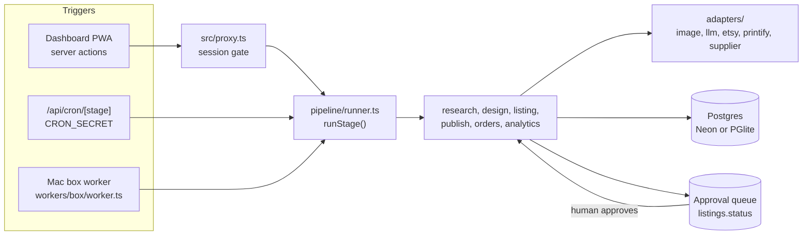

# Architecture

Etsy Autopilot runs a staged pipeline (research, design, listing, approval, publish, orders, analytics) for one Etsy shop. Stages talk to external services only through adapter interfaces, and anything outward-facing waits for a human decision in the approval queue.

## Modules

| Module | Responsibility | Key files |
| --- | --- | --- |
| Auth gate | Signed session cookie on every route except a short public list | `src/proxy.ts`, `src/lib/auth.ts`, `src/lib/login-limit.ts` |
| Pipeline | Stage functions, locking, logs, events, daily chain | `src/pipeline/runner.ts`, `src/pipeline/types.ts`, `src/lib/stage-lock.ts` |
| Adapters | Interfaces with mock or dry-run and live variants | `src/adapters/image/`, `llm/`, `etsy/`, `printify/`, `supplier/`, `marketplace/` |
| Persistence | Drizzle schema, Neon or embedded PGlite, migrations | `src/db/schema.ts`, `src/db/index.ts`, `drizzle/` |
| Safety and cost | Go-live decision, publish gates, AI budget reservations | `src/lib/publish-mode.ts`, `src/lib/publish-gates.ts`, `src/lib/ai-budget.ts` |
| Fees and listing rules | Etsy fee engine, title and tag validation, disclosures | `src/lib/fees.ts`, `src/lib/listing-validator.ts`, `src/lib/disclosures.ts` |
| Box execution | Jobs persisted first, then claimed by a local worker | `src/lib/box-jobs.ts`, `workers/box/worker.ts`, `docs/FREE_HOSTING.md` |
| Brain | Idea vault and approve flow feeding research | `src/lib/brain/`, `docs/brain.md` |
| Realtime | SSE with polling fallback | `src/lib/events.ts`, `src/app/api/events/` |
| UI | Pages and components | `src/app/(app)/`, `src/components/` |

## Boundaries and gates

- **Authentication:** `src/proxy.ts` requires a verified session cookie for all paths except `/login`, the manifest, `sw.js`, `/offline`, icons, `/api/cron/*`, `/api/media/*`, the Printify and Etsy webhooks, two bearer-token brain routes and `/api/health/deep`. Those exceptions authenticate inside the route (cron secret, webhook signature, bearer token). Login failures are throttled per client in `src/lib/login-limit.ts`.
- **Human approval:** `src/pipeline/publish.ts` selects only listings with status `approved`. The daily chain (`runDailyChain` in `src/pipeline/runner.ts`) covers research, design and listing, and restores the previous publish mode afterwards, so it cannot arm go-live.
- **Go-live:** `goLiveDecision` in `src/lib/publish-mode.ts` needs the dashboard confirmation (`CONFIRM`) and the host variable. `digitalDraftRefusal` in `src/lib/publish-gates.ts` refuses live drafts from the mock provider or without a delivery manifest. Tests: `tests/publish-mode.test.ts`, `tests/publish-gates.test.ts`.
- **Kill switch:** `runStage` checks the global and per-shop kill switch and per-stage pause before running (`src/pipeline/runner.ts`).
- **Spend:** `reserveAiBudget` in `src/lib/ai-budget.ts` reserves against daily and monthly caps before a provider call (`tests/ai-budget.test.ts`).
- **External calls:** only inside `src/adapters/`; the default adapters are dry-run or mock.
